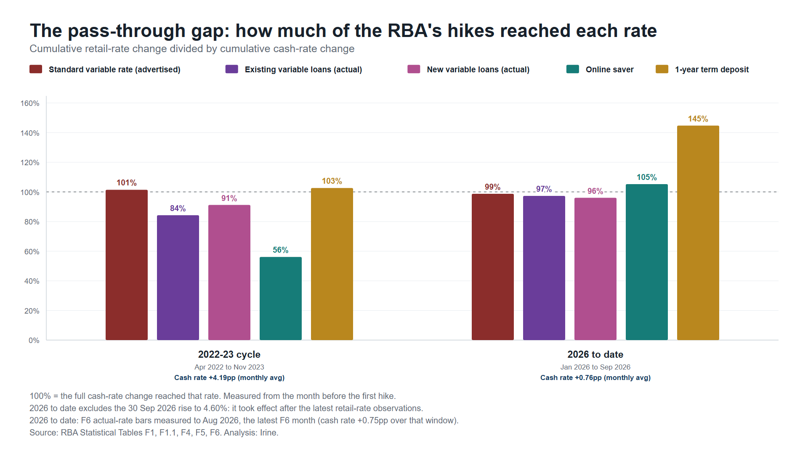

# RBA pass-through gap: mortgages vs savings

How much of the Reserve Bank of Australia's cash-rate rises reached mortgage and savings rates, comparing the 2022–23 tightening cycle with the 2026 cycle to date. Mortgage pass-through is measured two ways: with the banks' advertised standard variable rate, and with the average rates borrowers actually pay.

Data: RBA Statistical Tables, downloaded 12 October 2026. Monthly data runs to September 2026; the actual-rate table (F6) runs to August 2026.



## Findings

| Rate | 2022–23 cycle | 2026 cycle to date |
|---|---|---|
| Standard variable mortgage (advertised, F5) | 101.4% | 98.7% |
| Existing variable loans (actually paid, F6) | 84.2% | 97.3% |
| New variable loans (actually paid, F6) | 91.2% | 96.0% |
| Online saver (F4) | 56.1% | 105.3% |
| 1-year term deposit (F4) | 102.6% | 144.7% |

- The advertised mortgage rate passed on the full 2022–23 rise, but rates borrowers actually paid passed on less, and savers far less.
- The borrower–saver wedge widened 1.90 percentage points over 2022–23 on advertised rates, and 1.18 points on rates actually paid.
- The RBA raised the cash-rate target to 4.60% effective 30 September 2026. The retail-rate data published so far predates that move, so the 2026 figures cover the February, March and May rises only.
- The 2026 cycle so far is a 0.75–0.76 point rise, so its ratios are noisier than 2022–23's.

The table uses the monthly-average cash rate (F1.1). The dashboard keeps the July version's month-end cash rate (F1 daily), so its figures differ slightly (e.g. existing loans 82% rather than 84% for 2022–23).

## Interactive dashboard

`PassThroughGap_Dashboard.html` (and `index.html`, the copy GitHub Pages serves) is a single-file dashboard: KPIs, the transmission overlay, the pass-through scorecard for every cycle since 2006 (fast vs full), the wedge since 2004, and the episode matrix. It uses the month-end cash-rate target from the RBA's daily table, as the July 2026 version did. Rebuild with `python work/build_dashboard.py` (needs pandas and openpyxl).

## Contents

```
PassThroughGap_Dashboard.html   the interactive dashboard (index.html is the same file, for GitHub Pages)
data/raw/        RBA tables as downloaded (F1 daily, F1.1, F4, F5, F6) and SOURCES.txt
work/            build_dashboard.py + dashboard_template.html (dashboard),
                 build_passthrough_mortgage.py (charts, stats, post), merged.csv, episodes.csv
output/          charts (PNG + HTML, portrait 1080x1350 and widescreen 1920x1080),
                 passthrough_stats.txt, methodology.txt, draft_post.txt, verification_dump.txt
output/dashboard_data/   tidy CSVs: monthly rates, pass-through by cycle, RBA decisions, hike by hike
```

## Rebuild

Needs Python 3.10+ (standard library only) and Google Chrome or Microsoft Edge for the PNG screenshots.

```bash
python work/build_passthrough_mortgage.py
```

To refresh the data, download the latest tables into `data/raw/` from `https://www.rba.gov.au/statistics/tables/xls/<file>`, where `<file>` is `f01d.xlsx`, `f01hist.xlsx`, `f04hist.xlsx`, `f05hist.xlsx` or `f06hist.xlsx`, then rebuild.

## Method

Pass-through is the change in a retail rate divided by the change in the cash-rate target, from the month before a cycle's first rise to the cycle's last month of data (or each series' own latest month). The cash rate is the monthly average of the target (F1.1); the daily table (F1) dates each decision, so months that only carry over a late-month decision are flagged in the hike-by-hike figures. F4 and F5 are advertised rates; F6 averages hide wide differences between borrowers and lenders. See `output/methodology.txt`.

## Source and licence

Data © Reserve Bank of Australia, from the [RBA Statistical Tables](https://www.rba.gov.au/statistics/tables/), used under the RBA's copyright terms (Creative Commons Attribution 4.0 International). This is independent analysis, not produced or endorsed by the RBA.
